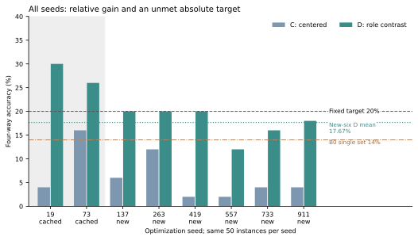
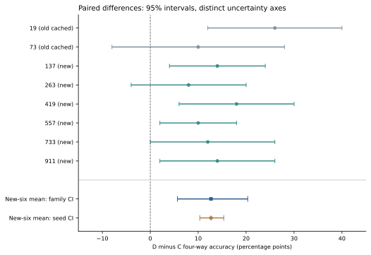
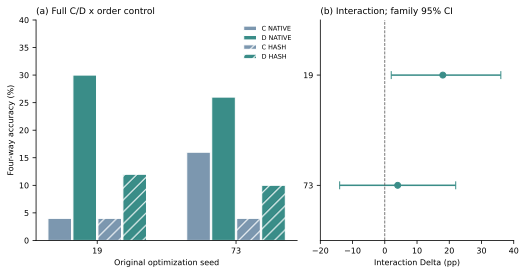

# 冻结特征时间问答的角色差分与顺序效应

作者、单位：待作者填写。基金：待作者填写。

## 中文摘要

时间问答中的事件识别与问题角色绑定不必同时成功。本文在冻结Qwen3-VL-4B-Instruct特征上，以同容量时间读出头比较中心化及标量RMS标准化C、问题角色差分D及有限无关锚对照。DyBench发布者拼接问答的自建划分含Breakfast训练68对、验证11对、开发54对，另有已多轮使用的50Salads来源留出50对。每对由两视频与两互补问题构成四格。固定50实例上，六个指定新优化种子全部出现正净增，平均四格全对率由C的5.00%提高至D的17.67%，净增12.67个百分点。固定六种子的来源family区间为[5.67,20.33]个百分点；固定50实例的种子区间为[10.33,15.33]个百分点。问题不敏感率由52.67%降至19.00%，但这不是理解正确率。原两个种子的正常顺序相对内容排序，D分别多答对9、8例，角色与顺序交互为9、2例，第二交互区间含0。D均值未达到事前20%项目目标，开发集也保留负向结果。证据支持固定接口上的有限相对收益，不能认定独立来源泛化、新算法或特定因果机制。

关键词：视频问答；冻结特征；问题角色；时间顺序；优化复验

## English abstract

Event recognition and question-role binding need not succeed together in temporal question answering. Using frozen Qwen3-VL-4B-Instruct features and capacity-matched temporal heads, we compare centering with scalar RMS standardization (C), question-role contrast (D), and a limited unrelated-anchor control. A custom split of publisher-composite DyBench questions contains 68 training, 11 validation, and 54 development Breakfast pairs, plus 50 previously used 50Salads source-holdout pairs. Each instance combines two videos and two complementary questions. On the same 50 instances, all six specified new optimization seeds yield positive net gains: mean four-way accuracy increases from 5.00% to 17.67%, a 12.67-percentage-point gain. The source-family interval, conditional on the six seeds, is [5.67,20.33] points; the seed interval, conditional on the 50 instances, is [10.33,15.33] points. Question-invariance decreases from 52.67% to 19.00%, which is not an understanding-accuracy measure. In the original two seeds, native order gives D nine and eight additional correct instances relative to content sorting; role-by-order interactions are nine and two, with the latter interval including zero. D does not reach the prespecified 20% project target, and negative development outcomes are retained. These results support a bounded relative effect at the frozen-feature interface, without establishing independent-source generalization, algorithmic novelty, or a specific causal mechanism.

Keywords: video question answering; frozen features; question roles; temporal order; optimization replication

## 1 引言

时间问答至少涉及两个可分的问题：视频包含哪些事件，以及当前问题把哪一个事件放在关系的主语或参照位置。事件识别充分，并不保证问题角色被正确绑定。若交换两个事件名称后答案不变，单项偶然答对仍可能掩盖关系判断失败。本文研究的具体问题是：在固定视频和文本特征上，显式提取当前问题与角色交换文本之间的差，是否比普通标准化更容易得到正确的四格答案；这种差异是否伴随问题交换响应，并依赖时间单元的显式顺序。

为隔离可训练容量、训练数据与优化预算，我们采用同一冻结Qwen特征和同一个时间读出头，仅改变问题输入视图。C定义为“中心化及标量RMS标准化”，D为角色差分后采用同形式标准化，另以无关锚差分N作有限负对照。同一优化种子共享实际初始化和采样序列，推理每次只输入当前视频与当前问题。此比较检验固定接口上的可利用性，不改变冻结语言模型内部推理，也不能直接定位角色信息在何层丢失或恢复。

证据组织分为三层：先比较角色视图的答题和问题交换响应，再检验六个指定新种子下的优化变化，最后在原两个种子上比较正常顺序与内容固定排序的完整交叉设计。开发集的较弱和负向结果同时报告。项目此前设定的20%绝对目标用于决定是否继续投入，不能替代科学效应描述。因此，本文同时保留固定来源上的相对增益和未达到绝对目标的事实。研究定位是有限受控实证观察，不将差分、四格或响应诊断本身作为新算法主张。

## 2 相关工作

Qwen3-VL技术报告介绍了视觉、文本和视频能力及其架构设计，构成本文冻结模型的来源[1]。本文实际使用的抽帧与特征接口则以已闭合实现为准，不能用报告中的总体能力替代特定缓存的有效性。CRPO以反事实视频变化约束回答行为，并提出DyBench[2]；EIGV也已研究对问题关键变化保持敏感、对无关环境变化保持不变的原则[6]。因此，变化响应、等变性或反事实配对本身均不作为本文原创性主张，我们也未复现这些完整训练方法。

组合式诊断同样具有直接先例。TimeBlind使用最小视频对与互补问题考察时空组合能力[4]，Winoground提供了视觉与语言组合关系的成组诊断背景[8]。本文借用配对思路组织自建时间问答，不把四格指标视为新贡献，也未运行TimeBlind模型评估。Kamath等针对对比式视觉语言模型研究文本向量中的组合信息可恢复性[5]。该研究提示应关注文本压缩接口，但不能直接证明Qwen纯文本末位置表示具有相同缺陷，更不能据本文结果定位相同的因果瓶颈。

时间信息如何跨编码器、投影器与语言模型传递已有专门研究，其逐帧播放方向任务与本文的动作片段交换判断并不相同[3]。我们没有进行层间信息追踪，不能由小头的顺序收益反推某个模块已经被诊断。多次随机运行和分布报告也已有方法论依据[7]；本文据此完整保留指定种子的结果，但不借其他任务的统计结论为本实验提供显著性认证。上述文献均为相关背景，未被当作同协议运行的数值基线。

## 3 方法与数据

### 3.1 数据证据、划分与四格构造

实验采用DyBench固定revision `fc9a9e8dbd11107fa47f953f1367c0bcd2dbb405`的事件顺序材料，构建自己的开发划分，而非报告官方零样本测试。历史准备记录中，Breakfast的133对在原录制身份、参与者、摄像机与来源组上逐项联接。按固定来源组哈希分为68对训练、11对验证、54对开发，对应25、4、20个参与者组，三池来源组不交叉。另将50Salads的50对全部保留为来源留出，按发布文件的25个编号family各含两试次聚类。该编号关系没有被提升为逐项验证的参与者或厨房身份。

问答真值采用PUBLISHER_COMPOSITE_QA证据层，即依赖发布者两动作片段拼接及其答案。原视频对表示片段次序交换，不应统称为逐帧倒放。历史上的51对严格事件标注联接与后来采用的133对发布者问答属于不同证据层；扩展样本没有补足严格事件审核的证据要求。本文没有新增逐成员剪接清单或人工逐帧动作审核。来源留出与训练数据同属DyBench构造管线，物理来源、转码或裁剪重叠及模型预训练暴露仍未知；来源组不交叉不等于这些更强独立性已经成立。

每个实例由两视频与两条事件角色相反的问题组成。设原格二值标签为y，则标签矩阵为[[y,1−y],[1−y,y]]。这里y不必恒为“是”；原绑定决定其方向。两个轴交换分别翻转答案，四个格都进入训练和评估。视频名、原序或交换标记、来源身份、格编号和标签不作为模型输入。推理每次只接收当前视频特征与当前原问题，不读取另一格预测或根据配对结果修复答案。四格构造约束的是任务评价，而非要求程序把某个输出机械翻转。

### 3.2 冻结特征与共同时间读出器

基础模型为本地Qwen3-VL-4B-Instruct，全部主模型参数保持冻结。历史特征抽取对每段视频取12个覆盖全时域的均匀中点目标，以最近时间戳帧形成224×224 RGB输入。原生处理器将相邻双帧形成6个tubelet；主视觉merger在语言解码器之前输出的每个时间单元含49个空间token，仅作空间均值，得到6×2560矩阵V，不取DeepStack替代。问题h(q)为纯文本解码器末层最后有效位置的2560维hidden。这不是专为跨模态检索训练的共同embedding，同维度不保证视频与问题天然语义对齐。

共同小头将视频与问题分别线性投影到64维。视频支路叠加固定正弦位置编码，经无仿射参数的LayerNorm与核宽3的一维卷积残差、GELU形成时间表示；问题支路经线性层与GELU形成g。两者内积除以8后沿时间softmax，得到注意权重。模型汇总加权内容u以及固定坐标ξ从−1到1的加权方向项o，拼接[u,o,g,u⊙g]，由256→64→1的MLP输出二元logit。共同头含356673个真实参数，C与D不增加可训练normalizer。结构并非强制奇对称，角色交换的差向量也不直接决定最终答案符号。

### 3.3 问题视图与训练集标准化

记τ(q)为从当前问题原字符串严格解析两个事件并交换角色后生成的同模板文本，a(q)为无关训练问题锚。三种原始视图定义如下，其中N的除以2与D一致。

z_C(q)=h(q)，z_D(q)=[h(q)−h(τ(q))]/2，z_N(q)=[h(q)−h(a(q))]/2。

三者分别只在训练68对对应的84个去重问题集合Q上拟合均值向量μ_j与标量RMS s_j，再生成固定输入T_j(q)。统计与减法使用float64，输入转回float32；要求尺度有限且大于10⁻⁸，不添加稳定化epsilon，不作逐向量单位化、白化、裁剪或维度选择。相同统计形式控制统一尺度处理的差异，不能排除所有几何或优化解释。

μ_j=(1/|Q|)Σ_{q∈Q}z_j(q)，s_j=√{Σ_{q∈Q}Σ_d[z_j(q)_d−μ_{j,d}]²/(|Q|·2560)}。

T_j(q)=float32[(z_j(q)−μ_j)/s_j]，j∈{C,D,N}。

无关锚a(q)来自固定训练名单：按问题UTF-8字节序排列84条文本，将固定域标签与当前文本拼接后做SHA256，取前8字节大端整数对84取余为起点，循环选择第一个既非q也非τ(q)的训练问题；字面域标签及源码入口见补充材料。选择不使用来源、答案或分数。N仅在原两个种子运行，六新种子只复验C/D且沿用已冻结视图与normalizer。D由当前文本派生τ，不读取另一格预测或标签；已有特征缓存使本次小头训练不需再编码文本，但从原始文本冷启动仍需额外派生文本编码，不能据此声称端到端等成本。

### 3.4 训练控制与顺序干预

全部小头采用BCE、AdamW，学习率0.001、权重衰减0.01、betas=(0.9,0.999)、epsilon=10⁻⁸、梯度裁剪阈值1。每批8个四格实例即32个单项，固定250次真实反传与更新，只保留最后一步checkpoint，不早停、不按验证集选种子或模型。CPU使用float32、4线程。同一seed的C/D共享实际克隆初始化与250×8采样序列；种子同时改变初始化和批采样，不能把变化仅归因其中之一。两种子C/D/N比较完成1500步，后续16配置完成4000步；缓存复用不计作新的训练或独立样本。

六个预先固定的新seed为137、263、419、557、733、911，各只训练C_NATIVE与D_NATIVE。原19、73的正常顺序预测直接复用，只新增C_HASH与D_HASH。HASH将V的每行转为连续小端float32字节，按“行字节的SHA256摘要、行字节本身”升序排列六行；键中没有时间编号、问题或标签。它在训练与评估都使用，完整保留行内容。全部366个V通过行多重集合、幂等性与四个固定置换下相等检查，365个实际改变顺序。HASH删除显式跨单元排列，却保留单元内运动、编码器上下文及可能的隐含位置，不能称完全无时间模型。

### 3.5 指标、不确定性和固定判据

设c(i,v,q)表示第i实例、视频v、问题q的单项正确指示。单项准确率以4N为分母；视频对指标固定q并要求两视频都对，以2N为分母；问题对指标固定v并要求两问题都对，也以2N为分母；四格全对率要求四个c均为1，以N为分母。问题不敏感则要求p(i,0,0)=p(i,0,1)且p(i,1,0)=p(i,1,1)，相当于CONSTANT与VIDEO_ONLY两类之和。其余模式分为QUESTION_ONLY、CHECKERBOARD与MIXED；棋盘格还可能方向全反。问题不敏感不是正确理解视频的证据，响应变化也不是准确率提升。各类、翻转边与正确数直方图只是相同输出的代数重述。

配对不确定性以来源的25个文件family为簇，每次等概率有放回抽25簇，保留簇内两实例，按预定公共随机流产生10000次抽样，使用实际抽样N及线性2.5%和97.5%分位。全部配对、四头交互和新六种子平均差共享同一来源抽样。另用独立预定流对六个种子的整套50实例差值有放回抽六个种子，得到固定实例条件下的种子区间。来源区间固定当前六个种子，种子区间固定当前50实例；两者不是联合新来源置信认证，也不把6×50个运行结果当成300个独立视频。本文不新增显著性检验或据区间正负另设门。

四格全对要求同一实例所有格正确，单项改善未必改变该指标；净胜也不代表只纠正而没有误伤。完整附件保留单项、两类配对及纠正/误伤计数。计划成员和分母不删：早期基础评分实现将INVALID记为已完成但不正确，保留在计划分母；FAILED、NOT_RUN或未知状态使相关统计为NA，不能当成有效错误补零。后续角色视图与复验评分实现先要求所有格为CLOSED且预测为二元值，不接受其他状态后继续计算完整条件。不完整时相关指标和判据不可判定，而非删题或隐式计错。本次公开条件均完整有效，主数值不受该状态区分影响；分版本源码依据见补充材料。

后续复验前，项目把来源四格全对率至少20%与相对答题改善、响应变化共同设为继续投入标准，完整计数条件见补充材料。该阈值是项目决策要求，不是社区通用有效性或统计显著性标准。来源区间与种子区间描述不同条件下的变化，不能通过改阈值、合并旧种子或仅援引其中一个区间补救未满足的绝对要求。

## 4 结果

### 4.1 角色视图的答题与问题交换响应

两种子开发阶段，C来源得分为2/50、8/50，D为15/50、13/50，N为6/50、4/50；C相对D的问题不敏感实例分别多16、11例，固定答题门和响应门均通过。D−C答题区间分别为[12,40]、[−8,28]个百分点，第二个仍含0。因此该阶段提供两个固定种子的比较证据，不足以直接声称种子稳定或独立来源确认。N低于D不能单独排除普通标准化解释，真正的主对照仍是使用相同统计形式的C。后续未据这些结果调整差分系数、尺度、层或训练超参数。

### 4.2 多种子优化复验及两种不确定性

表1及图1保留全部原种子与新种子。六新种子的D−C净值分别为+7、+4、+9、+5、+6、+7例，6/6均正，平均+6.33/50，即+12.67个百分点。C平均2.50/50，即5.00%；D平均8.83/50，即17.67%，其中位数为9.50/50、范围6–10/50。相对优势在指定优化变化下保持同向，但D的绝对正确数仍低：六个结果中只有三个达到10/50，平均也未达到事前20%项目目标，完整稳定性要求未满足。这同时反映比较收益与当前任务仍有较多错误。

表1　全部种子的来源与开发四格全对数。来源分母50，开发分母54；19、73为两种子开发阶段缓存，其余为新训。各行不是新增来源，表内配对差不构成ensemble。数据来源为公开聚合表。

| seed与阶段 | 来源C | 来源D | 来源D−C | 开发C | 开发D |
|---|---:|---:|---:|---:|---:|
| 19，旧缓存 | 2 | 15 | +13 | 15 | 16 |
| 73，旧缓存 | 8 | 13 | +5 | 12 | 15 |
| 137，新 | 3 | 10 | +7 | 8 | 14 |
| 263，新 | 6 | 10 | +4 | 11 | 12 |
| 419，新 | 1 | 10 | +9 | 8 | 14 |
| 557，新 | 1 | 6 | +5 | 12 | 14 |
| 733，新 | 2 | 8 | +6 | 13 | 11 |
| 911，新 | 2 | 9 | +7 | 9 | 13 |

图1　相对收益与未达绝对目标同时呈现。每根柱为同50实例的一次固定小头评估，柱高为四格全对率，不附种子内误差条。灰底19、73为旧缓存，六个“new”为新优化种子。水平线分别为事前20%目标、新六D均值17.67%及单次冻结Qwen参考14%；B0不是八次独立运行，来源说明见补充材料。正文性能小数统一保留两位，图为原始公开版本；图内C: centered为中心化及标量RMS标准化C的简写。

六新种子的问题不敏感数，C平均26.33/50（52.67%），D平均9.50/50（19.00%），减少16.83例，即33.67个百分点。角色差分因而同时改变了正确答案和问题交换后的输出行为，但不敏感率下降不能单独证明关系理解正确，也不能补救绝对答题目标不足。原19、73与新六种子合并后D为10.13/50，只作描述，不能替换事前只用新六种子的判定样本。

图2保留全部八个种子的来源配对区间，包括含0和负下界。新六平均答题差的来源family区间为[5.67,20.33]个百分点；固定这些实例的种子区间为[10.33,15.33]个百分点。两个区间对应同一点估计、重采对象不同，不能合成一根代表总体泛化的误差条。对应D−C问题不敏感率差为−33.67个百分点，来源区间[−42,−25.67]、种子区间[−42.33,−23.33]。这些条件区间支持当前数据上的相对改善，却不取消未达20%绝对目标的结论。

图2　圆点及横线为各种子的D−C答题差与25个文件family重采样的95%区间，单位为百分点；零线用于判断区间是否跨0，不对应新增检验。底部两行分别为固定六种子的来源簇区间、固定50实例的种子区间，未将两类不确定性混合。全部区间使用各自预定公共随机流和线性分位；来源和seed重采样都没有新增视频。

### 4.3 时间单元顺序与角色视图的交互

图3及表2呈现原19、73的完整交叉设计。D正常顺序相对HASH分别多9、8个四格全对实例，表明保持六行内容并不保证相同答题表现。角色与顺序交互Δ分别为9、2例，即18、4个百分点，对应区间为[2,36]、[−14,22]个百分点，第二个包含0。因此两个点估计均为正，不等于两个交互都得到明确的区间支持。原计数要求虽均满足，完整项目要求仍因六新绝对均值不足而未满足；这里的有限顺序证据不能替代独立验证或定位具体因果层。

表2　来源N=50的C/D×顺序对照。正常顺序来自早期19、73缓存，HASH为后续新训；交互区间为共同来源簇抽样的四头联合差，不是两个区间相减。数据来源为公开条件表与交互表。

| seed | C正常 | D正常 | C_HASH | D_HASH | D顺序净增 | Δ例数 | Δ的95%区间/百分点 |
|---|---:|---:|---:|---:|---:|---:|---|
| 19 | 2 | 15 | 2 | 6 | +9 | +9 | [2,36] |
| 73 | 8 | 13 | 2 | 5 | +8 | +2 | [−14,22] |

图3　左图为同容量C/D在正常与HASH顺序下的四格全对率，每柱N=50，无新增误差条；右图为Δ与95%来源簇区间，seed73区间跨0。HASH在训练、评估同时使用并保留六行内容及单元内、上下文中的时间线索，故左图下降不等同完全去除时间信息。该图只支持当前配置的有限顺序证据，不能证明事件定位或某层因果机制。

### 4.4 开发集结果与冻结模型参考

开发54上的结果更弱。新六种子C平均10.17例、D平均13例，净增平均2.83例，且seed733由13降至11，负值保留。早期两seed的开发净增仅1、3例；在固定的“两事件已见但组合新”19例子层，D为5、2，C为4、3，并非两个seed都提高。该子层属于原开发分母，不是新增测试集，也没有被用于后续调参。因而来源留出上的较强相对收益不能扩张为所有组合泛化条件都稳定受益。

冻结Qwen的B0只运行一次，来源四格全对为7/50，即14.00%。这是与受训小头不同的推理管线：完整冻结模型直接接收视频和问题生成答案，小头则在已有视觉/纯文本特征上接受监督；可训练参数、监督经历、输入处理与冷启动编码成本都不同。它仅作上下文参考，不是容量匹配对照，也没有证明D统计上优于基础模型。六新D中seed557为6/50，低于B0的7/50；六新平均高于B0不能改写成每个seed都胜出。原分数的回溯缓存相等性说明放在补充材料，该说明不构成新推理或新评分。

## 5 讨论与局限

### 5.1 可保留的观察及不能定位的原因

当前数据支持一个有限观察：同一冻结特征、相同头容量与训练预算下，明确提取当前问题和角色交换文本之间的差，能比普通标准化得到更高的相对四格全对率，并减少问题交换不敏感。六新种子的同向差值比单个优选种子更有说服力，但它仍没有达到项目要求的绝对水平。保留前半句而删除后半句，会把有边界的实证观察变成成功叙事；只写“未通过门”而隐去6/6正差，则会掩盖确实存在的比较证据。

差分究竟改善了什么，仍未得到因果分解。它可能使角色相关方向更易被当前小头利用，也可能改变表示的尺度结构、优化条件或其他语义成分。普通标准化控制了统一形式的训练集统计，无关锚差分提供了有限负对照，但二者不构成对全部替代解释的排除。原q交换距离非零、HASH顺序变化或响应敏感度提升，都不能单独证明语义信息原本缺失、现在已恢复，或冻结LLM内部推理被修改。本文没有新的层选择、事件定位标注或因果模块干预来支持更强结论。

### 5.2 数据、统计与适用范围

先前响应诊断显示，来源上八个普通小头配置的问题不敏感率为60%–92%，冻结Qwen单次参考为22%；配对q或有序V的精确碰撞并集在各划分均为0。这提供了问题视图干预的动机，却不证明语义信息可恢复或成因已定位。扩池普通头也未自动改善：两个种子的A25为3、2例，A68为3、0例，各以50为分母。来源50例的两个归一化事件名称均未在训练68出现，仅是字面覆盖事实，不等于动作语义未见；来源、动作与表述同时变化，不能将差异唯一归因词汇。来源集合已多轮查看，六个优化种子没有增加原始来源；文件family重采样也未验证真实参与者、厨房或录制链独立。

尤其应区分优化复验与数据复验：前者检验固定输入下训练结果随随机设置的变化，后者才可能检验对另一批来源的适用性。本文完成的是前者，并在已有来源簇上描述抽样变化。两个条件轴各自有价值，却没有覆盖新的任务模板、动作分布或预训练污染状况。因而区间、来源名称和新种子数量都不能单独承担外部验证的含义。

20%门的作用也应被限定。它是后续实验前固定的项目投入标准，并非关于时间理解的普遍边界。当前结果距该标准不足，不意味着角色差分一般无效；相对均值区间为正，也不意味着应该放宽绝对目标。我们保留原判据而停止扩张这一配方，没有在观察到结果后补种子、调整系数或替换低分对照。独立来源验证若要开展，应另定许可、重叠与评估方案，而不能借论文写作继续搜索当前超参数。

### 5.3 计算与可复现性边界

小头训练不更新Qwen，不能表述为改进了冻结大模型本身。D需要额外派生文本表示，当前同CPU训练预算不等于端到端同成本。公开代码、聚合表与匿名family统计支持关键差值、既有区间及图形的算术复核；原媒体、特征和逐项预测未公开，不能宣称完整端到端公开复现。数据和代码入口为DyBench原论文[2]及公开仓库（https://github.com/floomeer83felix-source/vlm/tree/df50bf1c8389d20418bc56b5641f13f8f8392bfa）。[补充材料](supplement.md)列出完整判据、区间索引、评分状态与证据来源；公开修订目录为https://github.com/floomeer83felix-source/vlm/tree/main/docs/papers/frozen-role-order-study/review065。本稿没有新增实验或真值审核。

## 6 结论

在固定冻结特征、自建发布者问答划分与同容量读出器下，角色差分相对普通标准化的收益在六个指定新种子中均为正，平均四格全对率从5.00%提高到17.67%，平均增加12.67个百分点；但17.67%未达到事前20%绝对目标，完整稳定性门失败。原两种子的顺序与交互计数门通过，不能替代失败主门，也不能消除第二交互区间含0的限制。本文因此保留相对增益、响应变化与有限顺序证据，同时停止扩大当前配方的绝对成功主张；其价值是可追溯的有限实证观察，而非新算法成立、普适因果机制或独立来源泛化确认。

## 参考文献

[1] Bai S, Cai Y, Chen R, et al. Qwen3-VL Technical Report. arXiv:2511.21631,2025. https://arxiv.org/abs/2511.21631

[2] Du D, Liu J, Qin J, et al. Learning Spatiotemporal Sensitivity in Video LLMs via Counterfactual Reinforcement Learning. arXiv:2605.21988v2,2026. https://arxiv.org/abs/2605.21988v2

[3] Han P, Cheng F, Pereira L K, Liu Q, Kitazawa S. Tracing the Arrow of Time: Diagnosing Temporal Information Flow in Video-LLMs. arXiv:2605.07568,2026. https://arxiv.org/abs/2605.07568

[4] Li B, Zhao K, Zhang C, Mitra C, Nyandwi J D D, Bertasius G. TimeBlind: A Spatio-Temporal Compositionality Benchmark for Video LLMs. EMNLP,2026. https://aclanthology.org/2026.emnlp-main.1923/

[5] Kamath A, Hessel J, Chang K W. Text encoders bottleneck compositionality in contrastive vision-language models. EMNLP,2023:4933–4944. https://aclanthology.org/2023.emnlp-main.301/

[6] Li Y, Wang X, Xiao J, Chua T S. Equivariant and Invariant Grounding for Video Question Answering. arXiv:2207.12783,2022. https://arxiv.org/abs/2207.12783

[7] Reimers N, Gurevych I. Reporting Score Distributions Makes a Difference: Performance Study of LSTM-networks for Sequence Tagging. EMNLP,2017:338–348. https://aclanthology.org/D17-1035/

[8] Thrush T, Jiang R, Bartolo M, et al. Winoground: Probing Vision and Language Models for Visio-Linguistic Compositionality. CVPR,2022:5238–5248. https://openaccess.thecvf.com/content/CVPR2022/html/Thrush_Winoground_Probing_Vision_and_Language_Models_for_Visio-Linguistic_Compositionality_CVPR_2022_paper.html
