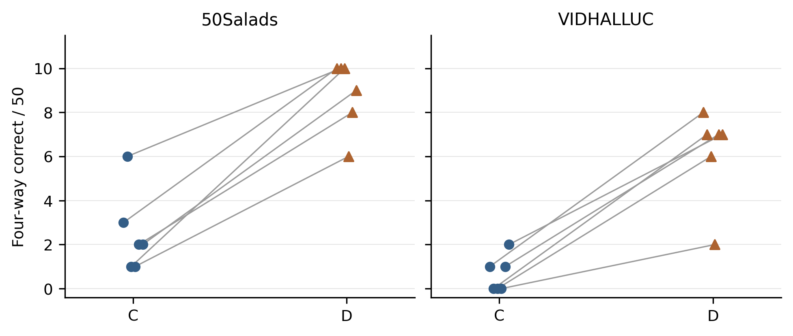
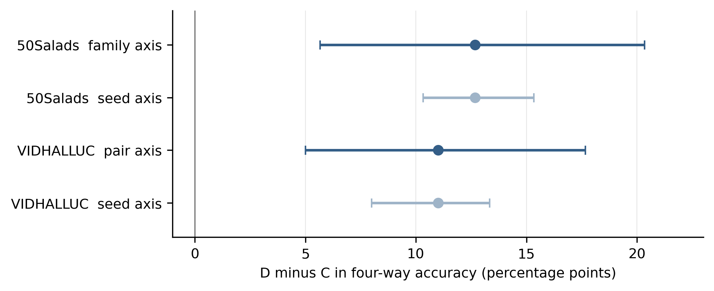

**摘要**　目的：考察冻结视觉语言特征下角色差分问题表示对事件先后问答的影响。方法：固定Qwen3-VL-4B-Instruct特征、356673参数读出头及训练预算，在六个指定种子下比较普通视图C和角色差分视图D，评价两视频、两互补问题的四格全对率。结果：50Salads已用50例的均值由5.00%升至17.67%，增加12.67个百分点；同一构造管线的VIDHALLUC新50例由1.33%升至12.33%，增加11.00个百分点；验证划分下降1.52个百分点，预设绝对门未通过。结论：D在特定冻结接口下存在受限相对收益，但独立来源泛化与时序理解机制未获证实。

**关键词**　视频问答；冻结特征；问题角色；时间顺序；受控比较

**Role-Contrast Effects in Video Question Answering with Frozen Features**

**Abstract**　Objective: The effect and limits of role-contrast question representations were examined for temporal video question answering under frozen visual-language features. Methods: The Qwen3-VL-4B-Instruct feature interface, a 356,673-parameter readout, training budget, and six paired random seeds were held fixed. A conventional standardized question view (C) was compared with a role-contrast view (D). Accuracy required all four answers for two videos crossed with two complementary questions to be correct. Results: On 50 previously used 50Salads instances, mean four-way accuracy increased from 5.00% to 17.67%, a gain of 12.67 percentage points. On 50 new VIDHALLUC items from the same construction pipeline, it increased from 1.33% to 12.33%, a gain of 11.00 points. The validation split declined by 1.52 points, and the original absolute-performance continuation threshold was not met. Conclusion: A bounded relative effect of question representation was observed at this frozen interface; independent-source generalization, semantic causal attribution, and generally improved temporal understanding were not established.

**Keywords**　video question answering; frozen features; question roles; temporal order; controlled comparison

**作者及稿件信息（投稿前由作者填写）**：作者姓名及顺序、单位（含省市和邮编）、作者简介、通讯作者（如适用）、基金项目（如有）均待真实信息确认；中图分类号待依据图书馆分类工具核定。本稿为匿名科学审阅版，尚不得直接作为投稿Word提交。

# 0 引言

“事件A是否先于事件B”同时要求模型区分视频中的先后关系和问题中的事件角色。模型对一条问题答对，并不意味着它能在视频次序或问题角色改变后继续答对。TimeBlind以最小视频对和互补问题构成严格的组合评价[1]，Winoground以词汇相同、关系不同的图文配对检验视觉语言组合性[2]。这类工作表明，单项准确率不能替代关系受控的配对评价；但配对成绩本身也不能独立证明模型定位了正确的视频时间证据。

本文关注一个更窄的问题：在已经冻结的视频和文本特征上，显式比较当前问题及其角色交换文本，能否使同容量读出器更容易利用问题角色，并提高四格答题表现？这种输入视图比较不修改视觉语言模型内部推理，也不把角色交换、向量作差或四格指标作为原创算法。研究重点是相对效应在指定优化变化和不同数据划分上的表现，以及现有证据不能支持的解释。

研究采用同一读出头、实际共享的初始化与采样序列，比较普通标准化C和角色差分D，并报告有限无关锚对照及正常顺序与内容排序的交叉实验。在六个指定新种子上保留全部结果，再冻结这些头评价新的发布条目。后续选择器干预和多事件实验只用于限定结论，不与主实验混合排名。本文据此区分三个层次：输入视图改善了某些答题结果，改善与问题角色响应相关，但其特异机制及对真实视频时间证据的普适利用尚未得到证实。

# 1 相关工作

## 1.1 时间组合评价与视频证据

TimeBlind通过最小时间差异与互补问句检验实例级时序组合能力[1]；Winoground在静态图文领域提供了词序变化与词汇保持不变的配对诊断先例[2]。VideoComp进一步在连续多事件视频上构造时序重排和内容错配负例，讨论视频—文本的细粒度对齐[3]。这些工作强调评测时必须控制非目标差异，但其任务、样本构造与本研究的DyBench衍生两事件问答不同，不能直接跨基准比较绝对分数。

## 1.2 视频依赖与语言捷径

Invariant Grounding for Video Question Answering研究问答与关键视觉区域的稳定关系[4]；Counterfactual VQA通过反事实推理讨论语言先验导致的偏差[5]。TOGA通过联合生成答案与时间定位监督提高视频问答的证据对齐[6]。这些方法关注视频或语言捷径，却与本研究冻结模型、只比较输入问题视图的实验位置不同。方法位置不同不意味着角色交换或向量差分具有原创算法地位，也不能从问句敏感性推导时间因果归因。

## 1.3 组合文本表示与时间关系

Kamath等使用恢复探针检验视觉语言模型文本表示中的组合信息[7]。NExT-QA将视频时间关系与因果动作推理区分评价[8]，NExT-GQA进一步要求视频问答同时给出与答案对应的时间证据[9]。TimeBridge研究通过起止状态与中间帧建模视频转移[10]。这些研究提示，角色表达、事件证据定位和视觉状态转移是不同层次的能力。本研究不直接测量文本角色信息可恢复度，也没有提供原视频连续L—M—R边界或新的时间定位算法。

# 2 实验设计

## 2.1 数据构造与划分

主实验采用DyBench事件顺序材料，固定数据revision为fc9a9e8dbd11107fa47f953f1367c0bcd2dbb405。每个实例含两段视频和两条角色相反的问题；视频对交换两个动作片段的次序，并非逐帧倒放。标签采用发布者拼接问答层：若第一格标签为$y$，四格标签按$y,1-y,1-y,y$绑定。四格全部进入训练和评价，文件名、来源标识、交换标记和答案不作为小头输入。

Breakfast的133个实例按预先确定的原来源组哈希划分为训练68、验证11、开发54个实例，对应来源组数为25、4、20，三池不交叉。50Salads的50个实例作为来源留出，按发布文件的25个编号family聚类，每个family含两试次；该文件关系未逐项验证为参与者或厨房身份。此来源集合已用于多轮开发，不能称为新的盲测。问答依赖发布者答案，扩展实例没有新增逐成员动作和剪接边界人工审核。

迁移评价采用同一DyBench管线下的VIDHALLUC来源50对新条目，冻结原六组C/D头和全部变换统计。条目资格与选择在产生本项目预测前固定；它增加了新条目证据，但不是独立作者基准确认。物理录制、转码或裁剪重叠以及主模型预训练暴露均未完整核实。六个seed的重复运行也不增加独立视频数。

## 2.2 特征接口与共同读出器

主模型为冻结的Qwen3-VL-4B-Instruct（型号身份以官方模型卡 https://huggingface.co/Qwen/Qwen3-VL-4B-Instruct 为准；该网页是资源身份入口，不作为正式会议论文计入参考文献）。每段视频取12个覆盖全时域的均匀中点目标，以最近时间戳帧形成224像素RGB输入。处理器将相邻双帧组织为6个时间单元；主视觉merger在语言解码器之前的输出，每单元49个空间token仅作空间均值，形成$V\in\mathbb{R}^{6\times2560}$。问题表示$h(q)$取纯文本解码器末层最后有效位置的2560维向量。两者并非专为共同检索训练的embedding，同维数不意味着天然语义对齐。

读出器分别将视频和问题投影到64维。视频支路先加固定正弦位置编码，再经无仿射LayerNorm、核宽3的一维卷积残差和GELU；问题投影经GELU得到$g$。时间单元表示与$g$的内积除以8后沿时间softmax，得到权重。读出器汇总加权内容$u$及按固定坐标从负1到1加权的方向项$o$，将$u,o,g,u\odot g$拼接后输入256到64到1的MLP，输出二元logit。C、D和有限锚对照使用同一结构，均为356673个可训练参数。

## 2.3 问题视图和优化控制

令$\tau(q)$由当前问题严格解析两个事件并交换角色生成，$a(q)$为仅从训练问题集合确定的无关锚。三种原始视图为：

$$z_C(q)=h(q),\qquad z_D(q)=\frac{h(q)-h(\tau(q))}{2},\qquad z_N(q)=\frac{h(q)-h(a(q))}{2}. \tag{1}$$

每种视图分别在训练池的84个去重问题组成的集合$\mathcal Q$上计算均值和标量均方根尺度，不逐向量单位化或白化。令维数$d=2560$，变换为：

$$\mu_j=\frac{1}{|\mathcal Q|}\sum_{q\in\mathcal Q}z_j(q),\qquad s_j^2=\frac{1}{|\mathcal Q|d}\sum_{q\in\mathcal Q}\sum_{k=1}^{d}\bigl(z_j(q)_k-\mu_{j,k}\bigr)^2. \tag{2}$$

$$T_j(q)=\operatorname{float32}\left[\frac{z_j(q)-\mu_j}{s_j}\right],\qquad j\in\{C,D,N\}. \tag{3}$$

统计和作差采用float64，尺度须大于十的负8次方，不添加稳定化epsilon。锚由训练问题UTF8排序和固定哈希规则决定，不使用答案或模型分数。推理仅接收当前视频与当前问题；D从当前文本派生角色交换文本，不读取配对预测、另一视频或真值。D冷启动需要额外文本编码，因此同小头预算不等于端到端等计算成本。

全部小头采用BCE和AdamW，学习率0.001、权重衰减0.01、betas为0.9和0.999、epsilon为十的负8次方，梯度裁剪阈值1。每批8个四格实例，固定250次更新，只评价最后一步，不按验证集选择模型或种子。同seed的C/D共享实际克隆初始化和批采样序列。原种子19、73包含C/D/N和顺序干预；指定新种子137、263、419、557、733、911只复验C/D。N没有在六新种子上复验，不能穷尽几何或优化替代解释。

## 2.4 指标与条件不确定性

单项准确率以$4N$为分母；固定一个问题要求两视频都对、固定一视频要求两问题都对，分别以$2N$为分母。四格全对率要求每个实例四个答案全部正确，以$N$为分母。问题不敏感率要求两条视频各自对互补问题的预测均相同；其下降不等同理解正确率提升。所有计划成员保留，正文条件均完整有效，不删除失败条目改变分母。

来源区间采用已登记的10000次配对重采样，50Salads按25个文件family保留簇内两实例，VIDHALLUC按50个文件视频对重采样；另一轴对六个seed整体结果重采样。分位数使用线性插值。来源轴固定当前六头，seed轴固定当前实例，两者不是联合新来源泛化区间，不能把六乘50当300个独立来源。这里引用既有区间，不新增检验或按结果重选区间。不同随机种子的结果须按重复实验分布而非独立视频样本解释[11]；区间仅刻画固定当前材料下的条件变化，不提供独立来源显著性结论。

# 3 结果

## 3.1 跨划分比较

表1汇总六个指定新种子的全部原划分及冻结头迁移。C和D在训练四格上均接近全对，因此早期相对比较并非建立在普通对照没有正常拟合之上。差异主要出现在来源变化后，但并不覆盖所有划分：验证池D均值低于C，开发池seed733为13对11，负结果保留。

表1　六个指定seed的四格全对率均值。百分点差由未舍入数值计算；训练、验证和开发属于Breakfast自建划分。

| 数据划分 | 每seed实例数 | C均值% | D均值% | D减C百分点 |
|---|---:|---:|---:|---:|
| 训练 | 68 | 97.79 | 98.77 | +0.98 |
| 验证 | 11 | 42.42 | 40.91 | -1.52 |
| 开发 | 54 | 18.83 | 24.07 | +5.25 |
| 50Salads已用来源 | 50 | 5.00 | 17.67 | +12.67 |
| VIDHALLUC新条目 | 50 | 1.33 | 12.33 | +11.00 |

50Salads上六个D减C净值为7、4、9、5、6、7例，均为正；D的问题不敏感率由C的52.67%降至19.00%。VIDHALLUC上六个净值为7、7、6、2、6、5例，同样均正；问题不敏感率由71.00%降至30.00%。该批新条目单项均值仅由49.33%升至53.58%，其中一个seed下降、一个持平，不能说所有指标在每次运行都提高。

表2　两个50实例集合的逐seed四格全对数。新条目迁移沿用原头，没有新增训练。

| seed | 50Salads C | 50Salads D | 新条目C | 新条目D |
|---|---:|---:|---:|---:|
| 137 | 3 | 10 | 1 | 8 |
| 263 | 6 | 10 | 0 | 7 |
| 419 | 1 | 10 | 0 | 6 |
| 557 | 1 | 6 | 0 | 2 |
| 733 | 2 | 8 | 1 | 7 |
| 911 | 2 | 9 | 2 | 7 |

{width=6.2in}

## 3.2 相对效应和顺序控制

50Salads平均增益12.67个百分点的来源family条件区间为5.67至20.33，seed条件区间为10.33至15.33；VIDHALLUC的11.00个百分点对应区间为5.00至17.67和8.00至13.33。图2分别展示两条重采轴，不能将它们合为一条总体泛化误差；两图均沿用已封存数据，未在本次写作中重算或筛选。当前数据支持有限的同向相对效应，尚不支持高绝对性能或独立来源确认。

{width=6.2in}

原两seed另有完整C/D与顺序交叉。内容排序HASH按六行视觉特征的字节摘要及行字节排序，训练和评价均采用同一规则；366个V中365个改变显式顺序，完整保留行内容。D正常顺序相对HASH分别多答对9、8例；交互差定义为正常顺序下D减C的差，再减去HASH下D减C的差，得到9、2例，即18、4个百分点，来源条件区间分别为2至36和负14至22。第二区间包含0，且只覆盖两个原seed，因此不认定一般稳定交互。HASH仍保留单元内运动、编码器上下文及可能的隐含位置，不能称为完全删除时间信息。

后续复验前曾设定D平均四格至少20%等共同投入要求。实际17.67%未达绝对项，其他相对答题和响应条件满足；完整要求失败，原配方停止扩张。20%是项目继续投入标准，不是科学效应或期刊录用的通用界限；不能删除失败项，也不能据失败项抹去相对收益。

## 3.3 后续对照与多事件边界

另行开展的语义选择读出变体虽然优于旧D，却未稳定胜过固定锚选择等强对照。将选择器问题输入换为训练均值后，聚合成绩保留与大量逐项预测改变同时发生。另一组24条三事件视频中，用共享均值视频特征替代当前视频特征，还可保留或提高部分头的成绩。这些结果限制一般问题语义定位和视频依赖的解释，但实验结构与主实验不同，不能回溯否定原C/D对比。详细变体、计数及来源见补充材料。

进一步的32源三事件真实片段排列实验采用另一个341633参数小头，训练、开发和测试为20、4、8源，每源含6种排列与6条定向问题。六seed三种监督臂在测试均为144/288单项正确、源级全对为0/8，训练也接近50%；完整基础模型REAL单项为176/288，即61.11%。随后只读诊断未发现所查绑定错误或精确输入矛盾，开发和测试小头的二元答案对六种排列均不变，具体失败原因仍未定位。这只支持该配方未学成，不否定所有问题条件化学习，也不能代替主实验已经能够拟合的事实。

# 4 讨论

## 4.1 相对效应的含义

主实验表明，改变问题输入视图能够改变同容量小头在当前构造中的四格表现与问题交换响应。普通标准化、同初始化和同批流减少了容量、统一尺度处理和单个幸运seed等解释，但没有控制全部表示几何或优化条件。D可能使角色相关方向更易被利用，也可能通过其他分布变化影响读出器；有限无关锚和顺序干预不足以区分这些原因。

在严格互补的两视频两问题构造中，确定性预测若对视频完全不敏感，就不能四格全对。但是，这一必要条件可以由视频外观、来源或裁剪相关信息满足，并不等于使用了时间顺序。已有成功实例因此要求输出能区分两段视频；但区分视频仍不证明使用了正确时间语义，其他视觉线索也可能影响答案。问题不敏感率下降、参数变化或较高组合一致性均不能单独证明模型理解时间关系。

## 4.2 适用范围与复现限制

结果限定于单个冻结模型、12帧采样、纯文本末位置向量与当前读出器。严格事件模板使角色交换规则明确，也限制自然问题的覆盖；D额外文本编码的成本没有包含在端到端公平性比较中。验证负差与开发负向seed说明，来源留出上的较大收益不能推广为所有问题分布均受益。新条目与主实验同属DyBench管线，发布者QA、物理来源和预训练暴露的限制继续适用。

公开代码、条件表和匿名簇统计支持主要数值与既有区间的算术复核；原媒体、特征、逐项预测和部分私有执行证据未公开，不能称为完整端到端公开复现。后续登记和核验的改进不追认早期记录缺口。补充材料提供阶段与证据索引，避免把不同构造的分数拼成统一排行榜。后续失败没有支持新的因果定位，因此不据此增加“首次发现某层时间信息丢失”等主张。

## 4.3 复现性、独立性与审稿风险

该比较属于固定特征接口、限定样本构造和预定种子下的描述性实证研究：已披露完整六种子计数、共用初始化与数据流、末步模型规则、训练池归一化范围、四格指标及条件区间，并在补充材料中保留源文件family分组口径和原始继续投入门失败信息。复现资料支持公开数值和图表的算术核查，但不包含可在任意机器上重新产生特征的完整媒体/权重/逐项预测，因此称为**部分可复核**，而非端到端公开复现。

50Salads的50个实例已被本项目多次用于开发，VIDHALLUC的50个条目虽为新条目却来自相同发布构造管线；来源、参与者与底层录像的物理独立性未完整确认。六个种子重复的是优化过程，不能乘以视频数扩大独立样本量。强无关锚仅覆盖两个原始种子，不能证明六个新种子上的效果具有角色语义特异性。验证集的-1.52个百分点和开发集单种子负差不应通过重新抽样、选择子集或改变停线阈值删除。这些限制意味着目前的贡献是**对一种问题输入视图的有界实证观察**，而不是经独立盲测证实的新方法。

# 5 结论

在固定冻结特征、同容量读出器和指定优化预算下，角色差分相对普通标准化在50Salads已用来源和VIDHALLUC同管线新条目上均有六个种子同向四格收益，平均增加12.67和11.00个百分点。改善在验证池不成立，顺序交互证据有限，后续强对照和多事件检查也未建立一般机制解释。本文的结论是问题视图在当前特征接口上具有受限的相对效应；独立基准泛化、角色语义的特异归因以及主模型视频时间理解的改进仍未得到证实。

# 参考文献

[1] LI B,ZHAO K,ZHANG C,et al.TimeBlind: A Spatio-Temporal Compositionality Benchmark for Video LLMs[C]//Proceedings of EMNLP.Budapest:Association for Computational Linguistics,2026:43801-43822.https://aclanthology.org/2026.emnlp-main.1923/.

[2] THRUSH T,JIANG R,BARTOLO M,et al.Winoground: Probing Vision and Language Models for Visio-Linguistic Compositionality[C]//Proceedings of CVPR.2022:5238-5248.https://openaccess.thecvf.com/content/CVPR2022/html/Thrush_Winoground_Probing_Vision_and_Language_Models_for_Visio-Linguistic_Compositionality_CVPR_2022_paper.html.

[3] KIM D,PIERGIOVANNI A J,MALLYA G,et al.VideoComp: Advancing Fine-Grained Compositional and Temporal Alignment in Video-Text Models[C]//Proceedings of CVPR.2025:29060-29070.https://openaccess.thecvf.com/content/CVPR2025/html/Kim_VideoComp_Advancing_Fine-Grained_Compositional_and_Temporal_Alignment_in_Video-Text_Models_CVPR_2025_paper.html.

[4] LI Y,WANG X,XIAO J,et al.Invariant Grounding for Video Question Answering[C]//Proceedings of CVPR.2022:2928-2937.https://openaccess.thecvf.com/content/CVPR2022/html/Li_Invariant_Grounding_for_Video_Question_Answering_CVPR_2022_paper.html.

[5] NIU Y,TANG K,ZHANG H,et al.Counterfactual VQA: A Cause-Effect Look at Language Bias[C]//Proceedings of CVPR.2021:12700-12710.https://openaccess.thecvf.com/content/CVPR2021/html/Niu_Counterfactual_VQA_A_Cause-Effect_Look_at_Language_Bias_CVPR_2021_paper.html.

[6] GUPTA A,ROY A,CHELLAPPA R,et al.TOGA: Temporally Grounded Open-Ended Video QA with Weak Supervision[C]//Proceedings of ICCV.2025:23593-23603.https://openaccess.thecvf.com/content/ICCV2025/html/Gupta_TOGA_Temporally_Grounded_Open-Ended_Video_QA_with_Weak_Supervision_ICCV_2025_paper.html.

[7] KAMATH A,HESSEL J,CHANG K W.Text encoders bottleneck compositionality in contrastive vision-language models[C]//Proceedings of EMNLP.Singapore:Association for Computational Linguistics,2023:4933-4944.https://aclanthology.org/2023.emnlp-main.301/.

[8] XIAO J,SHANG X,YAO A,et al.NExT-QA: Next Phase of Question-Answering to Explaining Temporal Actions[C]//Proceedings of CVPR.2021:9777-9786.https://openaccess.thecvf.com/content/CVPR2021/html/Xiao_NExT-QA_Next_Phase_of_Question-Answering_to_Explaining_Temporal_Actions_CVPR_2021_paper.html.

[9] XIAO J,YAO A,LI Y,et al.Can I Trust Your Answer? Visually Grounded Video Question Answering[C]//Proceedings of CVPR.2024:13204-13214.https://openaccess.thecvf.com/content/CVPR2024/html/Xiao_Can_I_Trust_Your_Answer_Visually_Grounded_Video_Question_Answering_CVPR_2024_paper.html.

[10] WANG Q,MORRISON A,SCHARR H,et al.TimeBridge: Self-Supervised Video Representation Learning via Start-End Joint Embedding and In-Between Frame Prediction[C]//Proceedings of CVPR.2026:39647-39658.https://openaccess.thecvf.com/content/CVPR2026/html/Wang_TimeBridge_Self-Supervised_Video_Representation_Learning_via_Start-End_Joint_Embedding_and_CVPR_2026_paper.html.

[11] REIMERS N,GUREVYCH I.Reporting Score Distributions Makes a Difference: Performance Study of LSTM-networks for Sequence Tagging[C]//Proceedings of EMNLP.Copenhagen:Association for Computational Linguistics,2017:338-348.https://aclanthology.org/D17-1035/.

